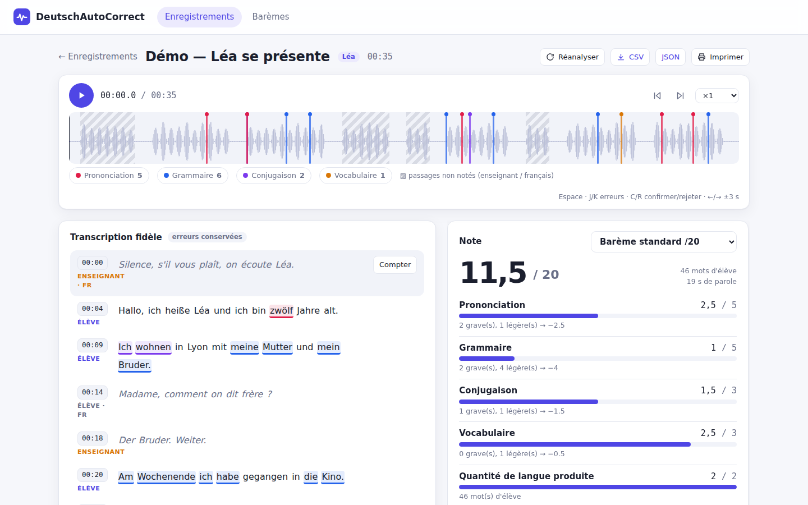

# DeutschAutoCorrect

Automatic grading of spoken German exams for middle school teachers. It produces
a faithful transcript that keeps the student's mistakes, detects grammar,
conjugation, vocabulary and pronunciation errors with clickable timecodes, and
computes a grade from a configurable rubric.



The teacher stays in charge: every detected error can be confirmed, rejected or
edited, and the grade updates live. The interface and the
[full user guide](docs/guide.fr.md) are in French, the language of its users.

## Why it is hard

Speech recognition models repair what they hear, which erases the very errors a
teacher needs to grade. The pipeline is built around that problem:

1. **Transcription that does not repair.** Whisper runs without context between
   segments or grammatical prompting, detects language per segment, and keeps
   word-level probabilities.
2. **An acoustic path for pronunciation.** Expected phonemes (espeak-ng) are
   compared with those actually spoken (wav2vec2 CTC), using edit costs tuned to
   typical mistakes of French speakers (ch-Laut, ü/ö, h, w/v, z, ei/ie, final
   devoicing). This path does not depend on a language model.
3. **Structured correction.** An LLM, either Claude or a local model, returns
   schema-constrained JSON on the annotated transcript, with an offline rule
   engine as a fallback.
4. **Classroom context.** French passages and teacher interventions ("Silence!",
   "Ruhe bitte") are detected, shown dimmed and excluded from the grade. One
   click reclassifies a segment.

Low-confidence words are flagged for review and only count once confirmed.

## Features

- **Rubrics as data**: per-category penalties and caps, language quantity tiers,
  manual criteria, and repeated-error policy. The grade is a pure function,
  replayed on every change.
- **Recitation mode**: paste the reference text to detect forgotten and replaced
  words, with a suggested rhythm score from long pauses and speech rate.
- **Fully local option**: with a local OpenAI-compatible server, no student data
  leaves the machine.
- **Graceful degradation**: if a configured engine is unavailable, the app falls
  back to an offline engine and says so.

## Getting started

Demo mode needs no model: the engines are mocks and the transcript is a scripted
scenario. It requires Python 3.11+, Node 20+ and `ffmpeg`.

```bash
make install
make build
make demo     # http://localhost:8010
```

For real recordings, with Docker and `nvidia-container-toolkit`:

```bash
cp .env.example .env
make up       # http://localhost:8010
```

The image bundles the front end, the API, faster-whisper, wav2vec2, `ffmpeg` and
`espeak-ng`. There is no authentication, so it binds to `127.0.0.1` by default.

| Variable | Values | Role |
|---|---|---|
| `DAC_ASR_BACKEND` | `faster-whisper`, `mock` | Transcription |
| `DAC_PRON_BACKEND` | `wav2vec2`, `mock`, `none` | Phoneme comparison |
| `DAC_CORRECTOR_BACKEND` | `anthropic`, `openai`, `rules` | Grammar, conjugation, vocabulary |
| `DAC_LLM_BASE_URL` | URL | Local OpenAI-compatible server |
| `DAC_DATA_DIR` | Path, default `./data` | SQLite database and audio |

## Tech stack

- **Back end:** Python, FastAPI, SQLite, faster-whisper, wav2vec2, espeak-ng
- **Front end:** React, TypeScript, Vite
- **Quality:** pytest, Vitest, an end-to-end smoke test, GitHub Actions

Each pipeline stage sits behind an interface with a `mock`, `rules` or `none`
implementation, so the whole pipeline runs in CI without a GPU or an API key.

```bash
make test
make lint
```

## Known limitations

- Whisper, wav2vec2 and the local corrector have run end to end on a GPU, but
  only on synthetic speech. The Claude corrector is only tested through test
  doubles. Validation on real student recordings is the next step.
- Pronunciation quality depends on the phoneme recognizer, which suffers from
  classroom noise and children's voices. It is a listening aid, hence the
  confirm/reject workflow.
- One file means one main student. There is no multi-student voice
  identification and no authentication.

## Documentation

- [User guide](docs/guide.fr.md): rubrics, recitation mode, configuration (French)
- [Architecture](docs/BLUEPRINT.md) and [work breakdown](docs/WORK_PACKAGES.md) (French)

## License

[MIT](LICENSE)
