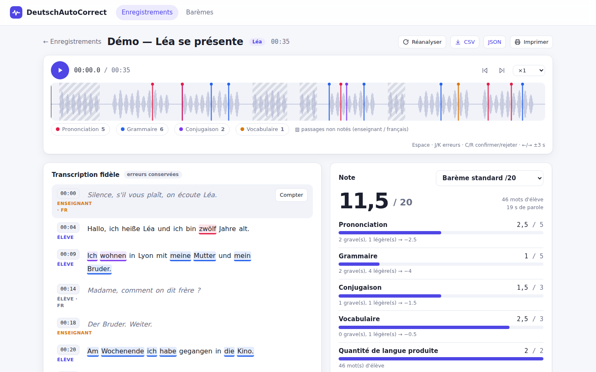

# DeutschAutoCorrect

Correction automatique d'enregistrements oraux d'allemand (collège) : transcription **fidèle** (les erreurs de l'élève sont conservées), détection des erreurs de **grammaire, conjugaison, vocabulaire et prononciation**, timecodes cliquables, et **note automatique** selon un barème paramétrable.



- Mélange allemand / français géré : les passages en français (demande d'aide) et les interventions de l'enseignant (« Silence ! », « Ruhe bitte ») sont détectés, affichés atténués et **exclus de la note** (reclassables en un clic).
- Chaque erreur est confirmable / rejetable / modifiable ; la note se recalcule en direct.
- Barèmes : critères par catégorie (pénalité légère/grave, plafond), quantité de langue (paliers), critères saisis à la main, politique des fautes répétées, arrondi.

Documentation : [`docs/BLUEPRINT.md`](BLUEPRINT.md) (architecture) · [`docs/WORK_PACKAGES.md`](WORK_PACKAGES.md) (découpage et dépendances) · [`CLAUDE.md`](../CLAUDE.md) (conventions de dev).

## Démarrage rapide (sans modèle : mode démo)

Prérequis : Python ≥ 3.11, Node ≥ 20, `ffmpeg`.

```bash
make install
make build                              # construit le front (servi par le back)
make demo                               # injecte un enregistrement de démo, lance http://localhost:8010
```

Sans configuration, les moteurs sont factices (`mock`) : l'appli est entièrement utilisable mais la « transcription » est un scénario de démonstration. Pour de vrais enregistrements, activez les moteurs ci-dessous. En développement : `make dev-back` + `make dev-front` (http://localhost:5173).

## Avec Docker (moteurs réels, le plus simple)

Prérequis : Docker + `nvidia-container-toolkit` (GPU), et un `.env` à la racine (`cp .env.example .env`).

```bash
make up          # = docker compose up -d --build ; puis http://localhost:8010
make logs        # suivre le démarrage (le premier lancement télécharge Whisper et wav2vec2)
make down
```

Une seule image contient le front construit, l'API, faster-whisper, wav2vec2, `ffmpeg` et `espeak-ng`. Le conteneur est en réseau hôte pour joindre un serveur LLM qui n'écoute que sur `127.0.0.1` ; il n'écoute lui-même que sur `127.0.0.1:8010` (`DAC_BIND=0.0.0.0` pour l'ouvrir au réseau local — il n'y a pas d'authentification). Les données restent dans `./data`, les poids des modèles dans `~/.cache/huggingface` (`DAC_HF_CACHE`). Sans serveur LLM sur la machine, `docker compose --profile llm up -d` en lance un (llama.cpp, port 8012, GGUF pris dans `DAC_LLM_MODELS_DIR`) : mettre alors `DAC_LLM_BASE_URL=http://127.0.0.1:8012/v1`.

## Utilisation réelle (sans Docker)

```bash
pip install -e "backend[asr,pron]"      # faster-whisper, torch, transformers
sudo apt install espeak-ng ffmpeg       # G2P allemand pour la prononciation
cp .env.example .env                    # à la racine ; puis ANTHROPIC_API_KEY ou un serveur LLM local
# DAC_ASR_BACKEND=faster-whisper  DAC_PRON_BACKEND=wav2vec2  DAC_CORRECTOR_BACKEND=anthropic|openai
```

L'API écoute sur le port **8010** (`make dev-back PORT=…` pour en changer ; le front suit via `DAC_API_PORT`) : le 8000 est souvent déjà pris par un serveur LLM local.

| Variable | Valeurs | Rôle |
|---|---|---|
| `DAC_ASR_BACKEND` | `faster-whisper` \| `mock` | transcription (GPU recommandé pour `large-v3`) |
| `DAC_PRON_BACKEND` | `wav2vec2` \| `mock` \| `none` | comparaison phonémique (nécessite `espeak-ng`) |
| `DAC_WHISPER_DEVICE_INDEX`, `DAC_WHISPER_COMPUTE_TYPE` | défaut `0`, `default` | GPU utilisé par Whisper ; `int8_float16` ≈ 2 Go de VRAM pour `large-v3` |
| `DAC_PHONEME_DEVICE` | `auto` \| `cpu` \| `cuda:N` | où tourne wav2vec2 (le CPU suffit) |
| `DAC_CORRECTOR_BACKEND` | `anthropic` \| `openai` \| `rules` | grammaire / conjugaison / vocabulaire (`rules` = filet hors-ligne limité) |
| `DAC_ANTHROPIC_MODEL` | défaut `claude-opus-5-5` | modèle du correcteur `anthropic` |
| `DAC_LLM_BASE_URL`, `DAC_LLM_MODEL`, `DAC_LLM_API_KEY` | défaut `http://127.0.0.1:8000/v1`, modèle servi | correcteur `openai` : serveur local compatible OpenAI (voir ci-dessous) |
| `DAC_DATA_DIR` | défaut `./data` | base SQLite + audio |

Si un moteur configuré est indisponible, l'appli retombe sur le moteur hors-ligne et l'indique (bandeau + `GET /api/health`).

### Tout en local (aucune donnée d'élève ne sort de la machine)

`DAC_CORRECTOR_BACKEND=openai` envoie le transcript à un serveur compatible OpenAI (`llama-server` de llama.cpp, vLLM, Ollama…) avec une sortie contrainte par schéma JSON (`response_format`). Si `DAC_LLM_MODEL` est renseigné et que le serveur sert un autre modèle (serveur partagé qui change de profil), la correction est sautée avec un avertissement plutôt que faite par le mauvais modèle. La qualité dépend beaucoup du modèle : préférer un modèle généraliste multilingue à un modèle de code.

Sur une machine où le GPU est déjà occupé par le LLM : Whisper `large-v3` en `int8_float16` tient dans ~2 Go de VRAM et wav2vec2 tourne sur CPU.

## Récitation ou lecture d'un texte (texte de référence)

Collez le texte que l'élève doit dire dans « Texte de référence » avant d'envoyer l'enregistrement (il est conservé pour les envois suivants ; modifiable ensuite sur la page de l'enregistrement, ce qui relance l'analyse). L'analyse relève alors, par rapport à ce texte, chaque **mot oublié** ou **mot remplacé** (catégorie « Texte de référence ») ; les mots en trop (hésitations, reprises) ne sont pas comptés, et la correction grammaticale n'est pas lancée.

Le barème préinstallé « Récitation / lecture » applique : texte /20 (−2 par mot oublié ou erroné), prononciation /20 (−2 par faute), rythme /2, puis une **moyenne pondérée** ramenée sur 20. Chaque critère a un coefficient modifiable dans l'éditeur de barèmes ; par défaut il vaut ses points max (20, 20 et 2).

La note de **rythme** est une suggestion calculée à partir de deux mesures : le nombre de pauses longues (plus de 1,5 s entre deux mots de l'élève, −0,5 chacune) et le débit (−0,5 sous 60 mots/min) — seuils réglables dans le barème. L'enseignant peut la remplacer sur chaque enregistrement ; vider le champ revient à la suggestion.

Limites : un passage dit dans le désordre est compté comme des oublis ; Whisper peut « réparer » un mot mal dit ou mal entendre un mot juste, d'où la relecture (confirmer / rejeter) ; les pauses de moins d'une seconde environ ne sont pas mesurées de façon fiable.

## Comment les erreurs sont conservées et détectées

1. **ASR non « réparateur »** : pas de contexte inter-segments, pas de prompt grammatical, détection de langue par segment, probabilités mot à mot conservées.
2. **Prononciation** : phonèmes attendus (espeak-ng) vs phonèmes réellement prononcés (wav2vec2 CTC, reconnus par segment puis répartis sur les mots par alignement — les timecodes de mots de l'ASR sont trop imprécis pour découper l'audio), comparés mot à mot avec des coûts adaptés aux francophones (ch-Laut, ü/ö, h, w/v, z, ei/ie, durcissement final…). Les mots reconnus avec une faible confiance sont signalés « à vérifier » et **ne comptent dans la note qu'une fois confirmés**.
3. **Grammaire / conjugaison / vocabulaire** : LLM (Claude ou modèle local) en sortie JSON structurée sur le transcript annoté ; filet de règles hors-ligne.

## Tests

```bash
make test        # pytest (backend) + vitest (frontend)
make lint
# test de bout en bout + captures (backend démo lancé) :
cd frontend && BASE=http://localhost:8010 node e2e/smoke.mjs
```

## Limites connues

- Whisper, wav2vec2 et le correcteur local ont été exécutés de bout en bout sur GPU, mais uniquement sur de la parole de synthèse ; le correcteur Claude n'est testé que via doubles. Une recette sur de vrais enregistrements d'élèves reste la prochaine étape.
- La qualité de la prononciation dépend du reconnaisseur de phonèmes (bruit de classe, voix d'enfants) : traitez-la comme une aide à l'écoute, d'où le workflow confirmer / rejeter.
- Un seul fichier = un élève principal. Pas d'identification vocale multi-élèves ni d'authentification (v1).
- Le moteur de règles hors-ligne ne couvre qu'un petit ensemble de fautes très fréquentes.
